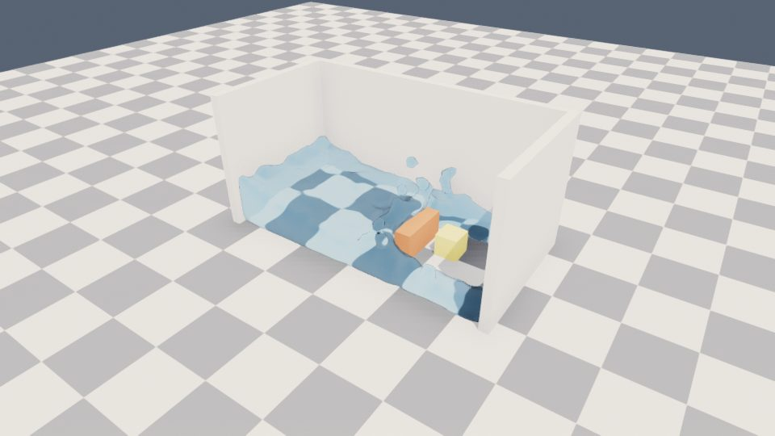
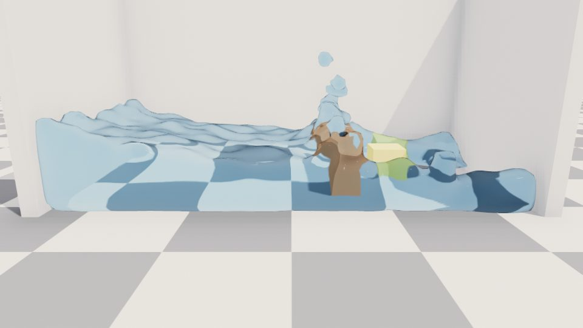
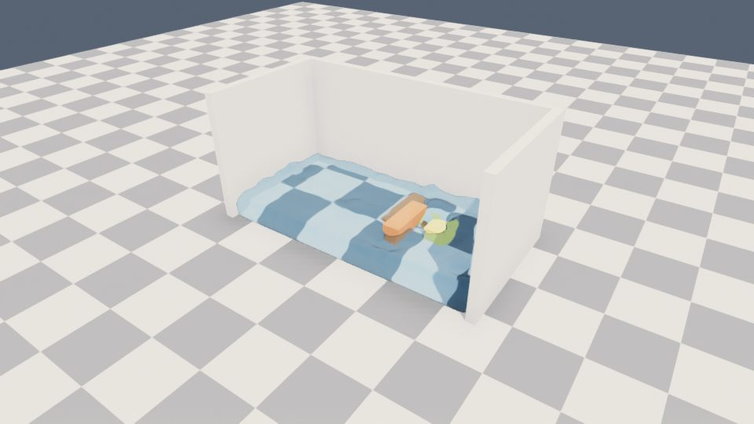

# 流体シミュレーション: Chrono で使えるもの（調査）と WizEngine での実装

対象は `third_parties/chrono` の **Chrono 9.0.0**（タグ 9.0.0 のソースを取得して
ヘッダ・CMake・デモを確認した）。結論を先に書くと、**流体を解く仕組みは 2 つ**
（Chrono::FSI の SPH と、Chrono::Multicore の流体コンテナ）で、ほかに「外の
流体ソルバと力をやり取りする口」がある。どれを選ぶかは **GPU（CUDA）を前提に
できるか** と **工学的な精度が要るか / 見た目と手触りでよいか** で決まる。

| | Chrono::FSI（SPH） | Multicore の `ChFluidContainer` | 自前の流体力（浮力・抗力） | 外部 CFD と連成 |
|---|---|---|---|---|
| 方式 | SPH（WCSPH / IISPH / I2SPH） | 3 自由度粒子 + 密度拘束（NSC ソルバに入る） | 物体ごとの近似式 | OpenFOAM 等が流れを解き、力を Chrono へ |
| 計算機 | **NVIDIA GPU（CUDA）必須** | CPU（OpenMP） | CPU（ほぼゼロ） | 別プロセス |
| WizEngine の系 | Core（`ChSystemNSC/SMC`） | **Multicore（`ChSystemMulticoreNSC`）専用** | どちらでも | Core |
| 剛体との双方向連成 | ○（`AddFsiBody`） | ○（流体粒子 ⇄ 剛体の接触） | 流体 → 物体の片方向 | ○ |
| FEA（ケーブル・板）との連成 | ○（`AddFsiMesh`） | × | × | △ |
| 精度・検証 | ダム崩壊・ポアズイユ流などの検証デモあり | 見た目寄り（2017 年頃の研究コード） | 近似 | 高い |
| 規模の目安 | 10⁵〜10⁶ 粒子 | 10⁴〜10⁵ 粒子 | 物体の数だけ | — |
| 導入コスト | 大（CUDA ビルド・GPU の取り合い） | 中（既にリンク済みのモジュール） | 小 | 大 |

## 1. Chrono::FSI（`src/chrono_fsi`、SPH）

- **SPH 法の流体と、剛体・FEA メッシュとの流体構造連成**。`ChSystemFsi(ChSystem*)`
  に普段の多体系を渡し、`AddFsiBody(body)` / `AddFsiMesh(mesh, ...)` で連成する
  物を登録する。流体は `AddBoxSPH` / `AddSPHParticle`、壁は BCE マーカー
  （`AddWallBCE` / `AddBoxContainerBCE`）。
- 解法は `FluidDynamics { IISPH, I2SPH, WCSPH }`（`SetSPHMethod`）。I2SPH / IISPH は
  非圧縮（線形ソルバ BiCGStab / GMRES）、WCSPH は弱圧縮の陽解法。
  `SetElasticSPH` で同じ枠組みのまま **粒状体の連続体モデル（CRM）** にもなる
  （Chrono::Vehicle の `CRMTerrain` = 砂地の車輪がこれ）。
- 出力は粒子ごとの位置・速度・密度・圧力・粘度（`GetParticle*`）と、連成した
  物体への力。
- デモ（`src/demos/fsi`）: DamBreak・CylinderDrop・Poiseuille_flow・Compressibility・
  Flexible_Cable・Flexible_Flat_Plate・Flexible_Toroidal_Tire・SingleWheelTest・BCE。
- **制約**: `CMakeLists.txt` が「CUDA が無ければ FSI を無効化」する = **NVIDIA GPU と
  CUDA Toolkit が必須**（`.cu` で書かれている。CPU 版は無い）。WizEngine では
  Filament（Vulkan）・映像エンコーダと同じ GPU を取り合う。Chrono 本体を
  `CH_ENABLE_MODULE_FSI=ON` で CUDA 付きにビルドし直す必要がある（Windows では
  VS2022 と CUDA の版の組み合わせに注意）。
- 物理の刻みは流体が決める（粒子間隔 h に対して CFL で 1e-4〜1e-3 s 程度）。
  WizEngine の 30〜240 Hz の物理ループより桁で細かいので、**流体のサブステップ**
  を別に回す作りになる。

## 2. Chrono::Multicore の流体コンテナ（`ChFluidContainer`）

- `src/chrono_multicore/physics/Ch3DOFContainer.h`。回転を持たない粒子（3 自由度）を
  `ChSystemMulticoreNSC::Add3DOFContainer` で系に足すと、**SPH のカーネルで測った
  密度を「ρ = ρ₀」の拘束として NSC のソルバに入れて**解く（Position Based Fluids に
  近い考え方）。剛体との接触も同じソルバで解くので、**物を浮かべる・水をかき混ぜる
  ・容器に注ぐ** が双方向で動く。人工圧力（表面張力っぽい凝集）・粘性・最大速度の
  上限を持つ。デモは `demo_MCORE_fluidNSC.cpp`（傾いた箱に水の球を落とす）。
  同じ仕組みの粒状体版が `ChParticleContainer`、雪の MPM が `demo_MCORE_snowMPM`。
- **CPU で動き、WizEngine は既に Multicore をリンクしていて、衝突系も
  `MULTICORE`**（`src/physics/PhysicsSystem.cpp`）= このコンテナが要求する条件を
  満たしている。新しい依存は要らない。
- **制約**:
  - Multicore 専用。WizEngine の自動切替（`Scene::requiredBackend`）に「流体がある
    → Multicore」を足す必要があり、**Core 専用の機能（FEA ケーブル・ブッシュ・
    定常荷重・AT のシャフト網・直接法・モーダル）とは同じシーンで使えない**。
  - 2017 年頃の研究コードで、設定値（`tau` / `epsilon` / `kernel_radius` /
    人工圧力の係数）の手探りが要る。工学的な検証（流量・圧力損失）には向かない。
  - 刻みはデモで 1 ms（= 1000 Hz）。粒子の間隔を 1〜3 cm にすると、コップ 1 杯で
    数万粒子になる。
  - 粒子の描画は自前（パーティクルの `Renderer::setParticles` の仕組みが流用できる
    が、水面に見せるにはスクリーン空間の流体描画か表面再構成が別に要る）。

## 3. Chrono 本体の「流体ソルバではない」口

- **`ChLoadBodyMesh`**（`chrono/physics/ChLoadBodyMesh.h`）: 三角メッシュの頂点ごとの
  力を剛体へ掛ける口。外部 CFD（OpenFOAM など）で求めた表面の圧力・せん断を
  毎ステップ渡す **共同シミュレーション** 用。
- **Chrono::FMI**（`src/chrono_fmi`）: FMU の取り込み / 書き出し。流体側を FMU に
  した 1D の水力・油圧回路（管路・弁・アキュムレータ）とつなぐ口になる。
- **Chrono::Gpu**（`src/chrono_gpu`）は粒状体の DEM（CUDA）で、流体ではない。
- 参考（9.0.0 より新しい版）: 上流の Chrono は FSI を整理し、SPH に加えて
  **時間領域のポテンシャル流（波と浮体）** の系を入れる方向にある（外部プロジェクト
  HydroChrono 由来）。サブモジュールを上げるときに見直す価値がある。

## WizEngine での実装（1 と 2）

調査のうち、既存の依存だけで進められる 2 つを実装した。仕組みの詳細は CLAUDE.md の
「流体」の章、見本は `assets/scenes/water.xml` と `assets/scenes/fluid.xml`。

### 1. 水面（`<water>`）= 自前の浮力・抗力

```xml
<water pos="0 0.8 0" size="4 3" density="1000" drag="1" lindrag="2" angdrag="1"
       wave="0.06" period="2.5" heading="20" flow="0 0 0"/>
```

- 水の範囲（中心 pos・X / Z の半分の広さ size、pos の y が静水面）の中で、水面より下に
  ある動く物へ、**浮力**（押しのけた水の重さを浮心へ）・**抗力**（二乗 + 線形）・
  **回転の抵抗**を毎ステップ掛ける（`components/FluidComponent`、計算は
  `fluid/WaterForces`）。Core / Multicore どちらでも、ほかの機能と一緒に使える。
- 箱は 4 × 4 × 4 の小箱で水面下の割合と浮心を出すので、傾けた箱は起き上がり、波の
  上では傾く。球は球冠の厳密な式。凸包のモデルは geom の半径の球。
- **波**は正弦波 1 本（深水波の分散関係で波長が決まる）で、水面の高さ・法線と水粒子の
  速度（深さで弱まる）が浮力と抗力に効く。**流れ**（flow）に乗って物が流される。
- 見た目は波で揺れる水面の格子 1 枚（不透明の光沢面）。
- 水そのものは動かない（物が押しのけても水面は盛り上がらない）。

### 2. 流体粒子（`<fluid>`）= Chrono::Multicore の `ChFluidContainer`

```xml
<option rate="250" substeps="4" .../>        <!-- 1 ms の刻み -->
<fluid spacing="0.025" density="1000" pressure="0.01" max="40000">
  <block pos="-0.4 0.2 0" size="0.2 0.2 0.28" velocity="0 0 0"/>
</fluid>
```

- 箱（block）を間隔 spacing の六方最密格子の粒子で満たし（`fluid/FluidSeed`）、
  シミュレート開始で Multicore の流体コンテナへ入れる（`physics/FluidParticles`）。
  密度の拘束と剛体の接触を同じ NSC のソルバで解くので、水は物を押し、物は水を押し
  返す（双方向）。
- 文書に `<fluid>` があると Scene が Multicore を選ぶ。Core 専用の機能（ケーブル・
  テレイン・AT など）と同じシーンでは作らない（理由を表示）。Multicore の無いビルド
  （`-DWIZ_USE_MULTICORE=OFF`）でも作らない。
- 粒子は系から外せないので、シミュレートを始め直すたびに系ごと作り直す。
- 刻みは細かく（Chrono のデモと同じ 1 ms）。粒子の間隔を半分にすると数は約 8 倍。
- 見た目は**粒子どうしをつないだ水の表面**を、透けて屈折する水の材質で描く（下）。
  `surface="false"` で粒子ごとの玉に戻る。

#### 水の表面の描き方（粒子をつなぐ）

粒子を 1 個ずつ玉で描くと「玉の集まり」に見えるので、粒子ごとに滑らかな山
（メタボール）を足し合わせた場を作り、その等値面を三角形にして 1 枚の水面にする。

1. **場**: 粒子ごとに半径 1.4 d（d = 粒子の間隔）の山 (1 − r²/R²)³ を、粒子の周りだけの
   格子（間隔 0.5 d）に足す。近い粒子の山は重なって 1 つの面になり、離れた粒子は
   小さな水滴として残る。
2. **面**: 等値面を Surface Nets で三角形に（格子の段々は 1 回ならして消す）。法線は
   隣り合う三角形の平均。1,800 粒子で 1 回 2〜4 ms（4 コアの CPU）。
3. **別スレッド**: 表面は描画とは別のスレッドで組み、描画は出来上がった最新の表面を
   送るだけ（描画を止めない。1〜2 フレーム遅れて追う）。
4. **材質**（`assets/materials/liquid.mat`）: Filament の画面空間の屈折
   （`refractionMode : screenspace`）。屈折率 `ior`（水 1.33）で向こう側がずれて透け、
   厚みのぶん色が吸われる（Beer-Lambert）。`rgba` は「厚み `clarity` (m) の水を
   通した色」= 浅い所はほぼ透明、深い所ほどこの色。表面は光源と環境マップを映す。

```xml
<fluid spacing="0.04" rgba="0.35 0.65 0.9 1" clarity="0.15" ior="1.33" roughness="0.04">
```

| 崩れ始め（0.5 s） | 真横から | 落ち着いた後（1.5 s） |
|---|---|---|
|  |  |  |

（Chrono 9.0 で崩した実際の粒子を、Filament 1.74 の本物の Renderer で CPU の Vulkan =
lavapipe に描かせたもの。環境マップ無し・手前の壁は外して撮った。）

### UI

World タブの「💧 流体」節（水面と粒子の有無・主な値・1 つ目の箱）と、アセット
パネルの 🌊 Water / 💧 Fluid タイル。2 つ目以降の箱は 📄 XML で書く。

### 確認したこと

本物の Chrono 9.0.0（Core + Multicore）をビルドして、WizEngine の PhysicsWorld を同じ
ソースのまま回した。

| 確かめたこと | 結果 |
|---|---|
| 水面: 密度 500 の箱（Core） | 中心 y = 1.0000（理論値 1.0 = 半分沈む） |
| 水面: 25° 傾けて落とした密度 400 のいかだ | 0.09° まで起き上がる・中心 y 1.0200（理論値 1.02） |
| 粒子: ダム崩壊（1,764 粒子・2 ms 刻み） | NaN 0・漏れ 0・反対の壁まで届く・浮いた箱を押し流す |
| 粒子: ダム崩壊（7,363 粒子・1 ms 刻み） | 同上（漏れ 0〜3 粒子） |
| 粒子: 浅い水へ落とした密度 500 の箱 | 浮く（中心 0.162 m、水面 ≈ 0.157 m） |
| 粒子: Reset（崩した後に書き戻す） | 最初の並びへ誤差 0 で戻り、2 回目も同じように崩れる |
| 粒子の重さ（4 コア） | 1,800 粒子・2 ms 刻みで 1 ステップ 9〜14 ms（実時間の約 1/5）、7,400 粒子・1 ms で 40〜90 ms |

途中で見つけて直したこと: Chrono 9.0 の Multicore のソルバは、段を分けて回す設定
（WizEngine の既定。転がり摩擦のため）で流体を入れると最初のステップで例外になる
（`ChIterativeSolverMulticoreNSC::SetR` が流体の拘束の行数を数え違える）。流体の
ある系だけソルバを 1 段（SLIDING。Chrono のデモと同じ）にした = その系では転がり
摩擦が効かない。

静止後の水は非圧縮の高さより 1〜2 割低い（密度拘束の反復で少し縮む）。

流体粒子はエンジン本体（Scene・描画・ブラウザ）で動くことを実機で確認済み。そこで Reset が
流体粒子を戻さない不具合が見つかり、直した（粒子を最初の並び・初速へその場で
書き戻す。シミュレート中に流体の設定を変えていたら系ごと作り直す）。

### まだ無いもの

水面（`<water>`）の透過・屈折、水が物に押しのけられる動き、粒子の水の泡・しぶきの
白さ・コースティクス、Chrono::FSI（SPH。CUDA が要る）、外部 CFD との連成
（`ChLoadBodyMesh`）。
